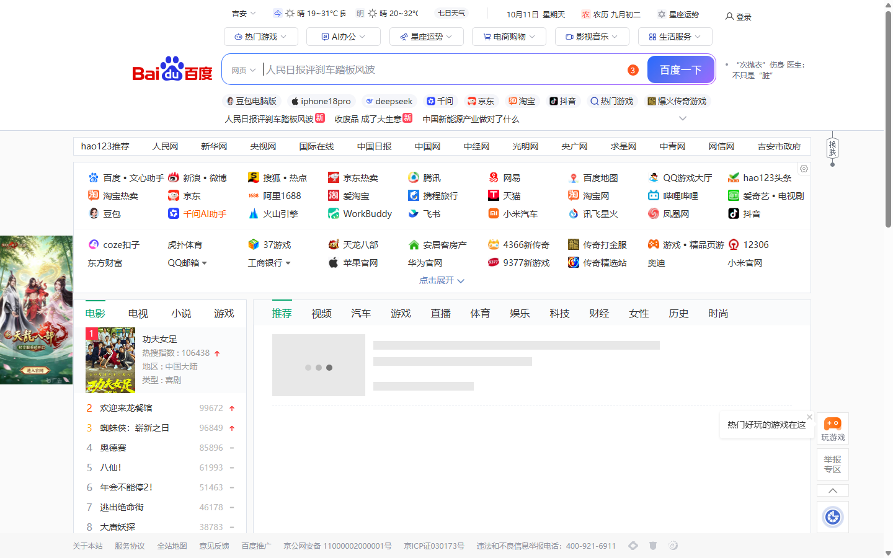
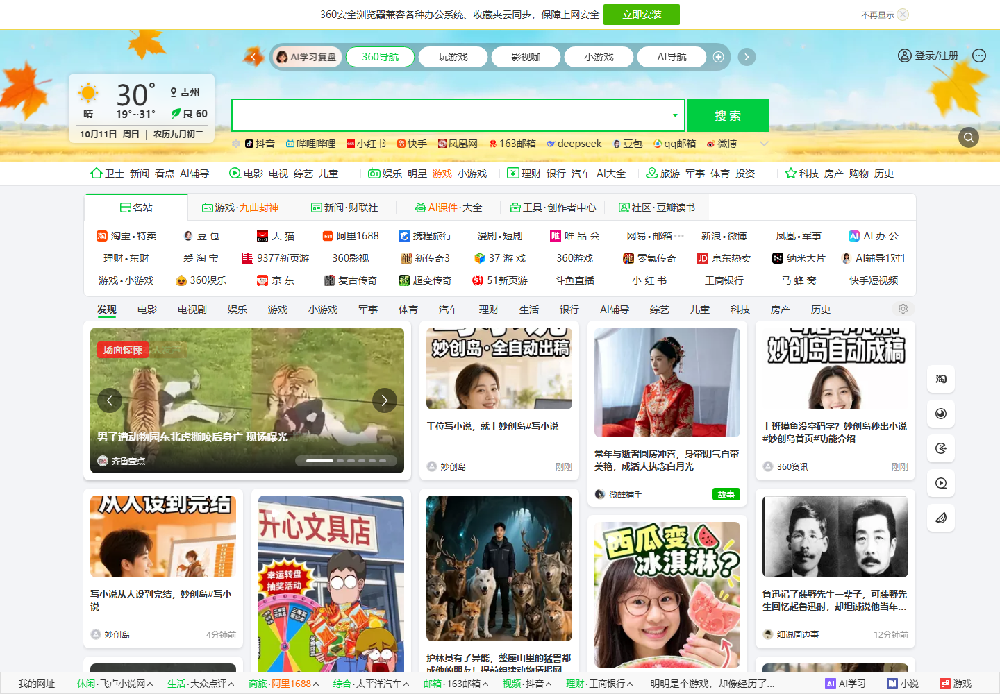
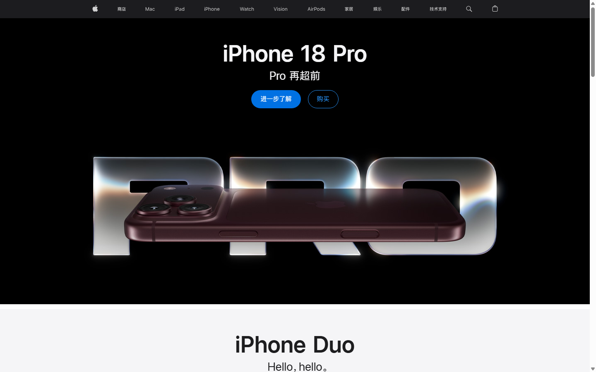
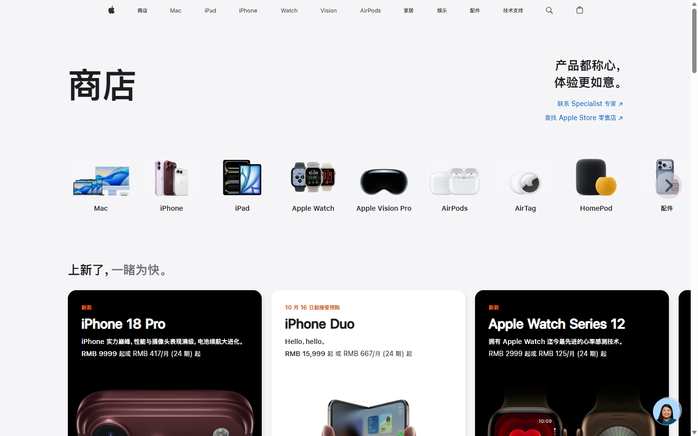
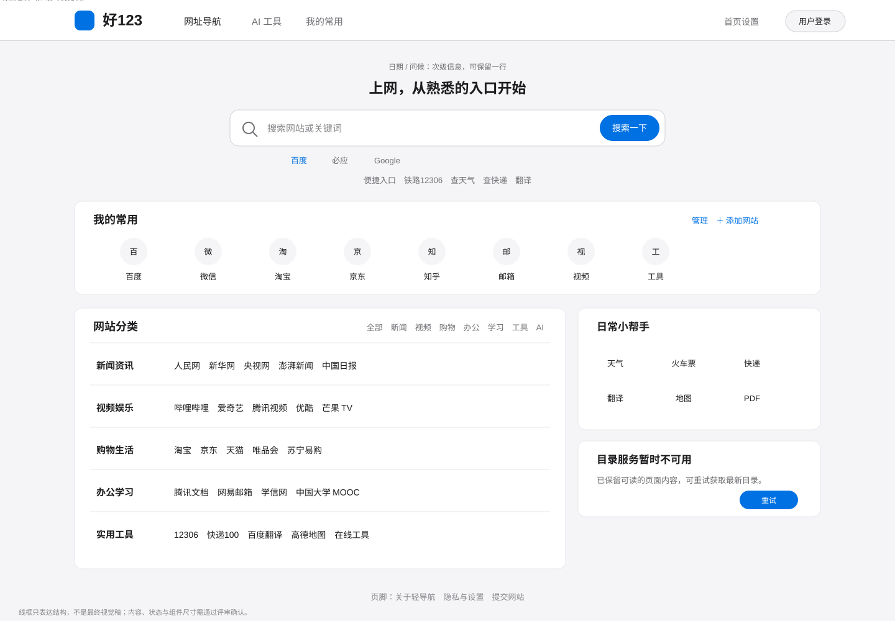

# 首页重设计参考截图采集单

> 用途：给设计评审/视觉实现者提供可核对的真实参考页面，避免只读抽象文字后由 AI 自行发挥。
> 基准时间：2026-10-11 ｜ 状态：已附 hao123、360导航、Apple 官网截图；360 页面在二次等待后完成渲染。当前截图均为官网直接访问的参考画面。
>
> 重要：截图用于分析布局与视觉原则，不代表页面内容完全稳定；页面含时效资讯、广告或动态推荐，不作为本项目需复刻的功能。

---

## A. 官方页面与采集矩阵

| 编号 | 参考对象 | 官方页面 | 页面中应截取的区域 | 本项目要研究的内容 | 不照搬的内容 |
|---|---|---|---|---|---|
| R1 | hao123 桌面首页 | [https://www.hao123.com/](https://www.hao123.com/) （搜索引擎收录入口也可能跳转至 `https://hao123.com/index.php`） | 页面最上方至首个主要内容区：品牌/导航、搜索框/引擎、快捷网址、第一组目录或内容 | 国内用户熟悉的搜索入口位置、快捷入口密度、首屏信息顺序 | 热点资讯流、广告、内容分发、其商标与专有资产 |
| R2 | 360导航桌面首页 | [https://hao.360.com/](https://hao.360.com/) | 顶栏、搜索/快捷站点区、常用网址组织、第一屏分类/内容区 | 网址入口的紧凑分组、名称识别、常用导航的空间利用 | 广告推广、内容流、商业推荐、其商标与专有资产 |
| R3 | Apple 中国首页（导航语言参考） | [https://www.apple.com.cn/](https://www.apple.com.cn/) | 顶部全局导航与黑底首页 hero | 全局导航简洁、对齐、低噪声 | 黑底产品 hero、品牌资产、文案 |
| R4 | Apple Store 中国（浅色视觉参考） | [https://www.apple.com.cn/shop](https://www.apple.com.cn/shop) | 顶部导航、浅灰页面、横向入口网格与产品列表 | 中性色、文字层级、入口网格、留白 | 商品照片、商品卡片、促销内容及品牌图标 |

### 采集设置（保证可对比）

- 桌面：浏览器窗口按 1440px 宽度、页面顶部（滚动位置 0）采集；当前 headless 截图使用 `--window-size=1440,900`，360 延迟重试图为 `1440,1000`，实际图片可见网页区域约 1440×900 / 1440×600，页面可能因视口/加载状态略有差异。
- 每站至少 1 张全屏截图；另各截 1 张关键区域局部放大图（如搜索框、快捷入口或导航/目录）。当前已有全屏参考，局部图可在后续评审补采。
- 360导航、hao123 页面可能有地域、时段、登录、A/B 测试或推广内容差异；截屏时记录日期、时间、是否登录及页面地址，不将偶发广告当作必须复刻的固定模块。
- 如自动播放内容干扰，可暂停后再截；不点击登录、下载、安装或推广按钮。
- 保存文件名：`reference-hao123-desktop-YYYYMMDD.png`、`reference-360-desktop-YYYYMMDD.png`、`reference-apple-desktop-YYYYMMDD.png`；局部图追加 `-search`、`-directory`、`-nav`。
- 所有截图均作为**评审参考附件**，不复制到线上产品、不嵌入最终网站资源。若对外发布该文档，先确认截图使用/传播许可；必要时用官网链接代替附件。

### 当前核实状态

- hao123 官方页面：`https://www.hao123.com/`；已取得本地渲染截图 `assets/reference-hao123-desktop-20261011.png`。
- 360导航官方页面：`https://hao.360.com/`；延迟等待后取得已加载的实际首页 `assets/reference-360-desktop-20261011-loaded.png`。最初即时截图 `assets/reference-360-desktop-20261011.png` 仅为空白加载态，评审使用时忽略。
- Apple 中国官网：`https://www.apple.com.cn/`；首页截图 `assets/reference-apple-desktop-20261011.png` 是深色产品发布首屏，仅观察全局导航的克制与对齐。另取得浅色 Apple Store 页面截图 `assets/reference-apple-light-local-shop.png`，用于观察浅色中性背景、产品入口图标网格、留白与文字层级；只抽象这些通用视觉原则，不复制其具体品牌资产与产品卡片。
- 截图使用直接访问官网的 Chrome 无头渲染，2026-10-11。页面真实状态会受地区、日期、A/B 测试与异步内容影响；不应把单次截图中的资讯、广告或促销视为固定要求。

---

## B. 需求文档中的建议图板顺序

评审材料中应按以下顺序直接展示截图，且每张图下紧接着写“借鉴点 / 禁止照搬点”，而非只放一组无说明的图片。

### 图 1：当前页面（用户提供截图）

**当前截图附件状态**：该截图仍位于原始会话附件区，未复制进此归档包；若离开当前工作区，图 1 图片可能无法显示。其它官方参考截图和目标线框均已随本目录归档。

**观察重点**：灰色山脉背景、深底白字导航/问候、搜索区及页面内容之间的切换；截图中目录服务提示与“重试”操作。此图只作为问题基线，不是目标视觉。

> 若交付包脱离当前工作区，需把用户截图经允许后复制到本 `assets/reference/` 目录再更新相对链接；不得假设其他评审者拥有 `.workbuddy/clipboard-images/` 本地路径。

### 图 2：hao123 桌面首屏（真实截图）

[打开 1440px 参考图原图](assets/reference-hao123-desktop-20261011.png)

官网链接：[打开 hao123](https://www.hao123.com/)

**截图说明**：当前截图捕捉到 hao123 的顶栏与天气/日期、搜索框、快捷网址区、导航分类和下方内容入口；页面含动态资讯与推广元素，截图仅用于布局观察。
**图注模板**：
- 借鉴：把“搜索—快捷入口—网站分类/内容”的入口顺序做得一眼可懂；站点名称和分组让用户可扫读。
- 不照搬：资讯流、广告、商业推广、过密的信息量与品牌资产。
- 对好123的结论：导航和搜索作为当前首页主任务；保留自有“常用”与目录，缩减不必要的装饰和内容竞争。

### 图 3：360导航桌面首屏（真实截图）

[打开 360导航参考图原图](assets/reference-360-desktop-20261011-loaded.png)

官网链接：[打开 360导航](https://hao.360.com/)

**截图说明**：官网首页包含天气与搜索、站点快捷区、分类/频道入口和内容卡片；其中有浏览器推广横条、广告和资讯推荐。截图为延迟等待后的实际页面，内容随访问时间和地区变化。本项目只借鉴快捷区与分类的识别方式，不引入推广横条、广告或资讯流。首次即时截图因异步加载过早为空白，已保留为加载态，不作为本图。

**图注模板**：
- 借鉴：密集网址入口的分组、名称可辨认性、首屏快捷访问效率。
- 不照搬：推广位、广告、内容信息流及其品牌图标/配色。
- 对好123的结论：分类目录保持连续链接结构，常用入口单独突出；避免把每条网址做成大卡片。

### 图 4：Apple 中国官网导航（深色首页截图）

官网链接：[打开 Apple 中国官网](https://www.apple.com.cn/)

**截图说明**：这张首页截图呈现深色全局导航与黑底产品发布首屏，只用于观察全局导航的简洁、对齐与低噪声，**不能作为本项目浅色配色的依据**。

### 图 5：Apple Store 浅色页面（中性色与入口组织参考）

官网链接：[打开 Apple Store](https://www.apple.com.cn/shop)

**截图说明**：浅灰底、深色标题、横向产品入口图标和产品卡片构成清楚的层级。对好123仅借鉴浅色中性色、文字层级、入口网格和留白；不复制苹果商品图、品牌图标、商品卡片或促销内容。此图可作为 Apple-like 配色方向的可视参考，但网址导航需保留更紧凑的链接目录，不做成产品商城。

**图注模板**：
- 借鉴：中性色背景与文字层级、充足但有目的的留白、简洁导航与克制强调色。
- 不照搬：大幅产品 hero、营销叙事、苹果商标、图标、品牌字形和官网内容布局。
- 对好123的结论：只借色彩秩序与视觉克制，不把导航站做成产品广告页。

---

## C. 参考截图后的落地目标（给 AI/设计实现者的明确约束）

拿到截图之后，不要写“参考 hao123 和 Apple 做得更好看”这类不可验收要求。实现前应先填写并确认以下量化/结构对照：

1. **首屏结构**：列出参考图中导航、搜索、快捷入口、目录的先后关系；目标页面保留哪些、移除哪些。
2. **模块尺寸**：记录参考图的顶栏高度、搜索区垂直高度、搜索框宽高、主内容最大宽度、内容区与页面边缘留白；选取适合本项目的目标值，而非盲目照抄。
3. **视觉权重**：标注首屏最醒目元素、次级元素、弱化元素；目标首要焦点必须是搜索与网站入口，不是背景插画/问候文案。
4. **色彩**：从 Apple 参考图只提取角色级原则（中性背景、文字层次、单一强调色）；根据项目当前色板定具体 token，并测对比度。
5. **网址目录**：根据 hao123/360参考图评审“常用入口”与“分类目录”如何分层；不引入广告/资讯流来填充空白。
6. **当前错误态**：以用户截图为基准，在目标线框中单独画出“目录服务暂时不可用 + 重试”状态，确保它不会被视觉重做漏掉。
7. **方案评审**：至少提供目标首页低保真线框或带标注的目标图，并与参考截图并排呈现。只有文字规格、没有图像对照和目标线框，不视为完成视觉方案。

---

## D. 目标线框（本次需求输出）

[打开目标线框原图](homepage-redesign-target-wireframe-2026-10-11.svg)

**线框说明**：这是结构草图而非视觉成稿。它明确要求：无大面积山景横幅；顶栏浅色、搜索为第一焦点；便捷入口紧跟搜索；常用网站在目录之前；目录采用分类+链接的紧凑结构；辅助工具放侧栏；目录异常时错误说明和重试仍保持可见。线框中的分类名称和网站名是示例，具体数据沿用项目现有目录。

### 目标图与参考图对应关系

| 目标区域 | 参考图观察 | 好123目标取舍 |
|---|---|---|
| 顶栏 | hao123/360 的国内导航站入口熟悉度；Apple 的全局导航简洁与对齐 | 保留品牌、三项主导航、设置/账户；采用浅色底、深色字，不做深色照片横幅叠白字 |
| 搜索区 | hao123/360 的显著搜索入口与引擎/快捷入口关系 | 搜索是首屏视觉焦点；引擎选择作轻量控件；搜索下方仅显示少量真实便捷入口 |
| 我的常用 | 导航站快捷网站组织方式 | 独立且可管理的常用区优先于目录；突出网站名称，图标仅辅助识别 |
| 分类目录 | hao123/360 的分组和密度 | 保留熟悉分类，但减少广告/资讯信息量；链接连续排列，不做全卡片化 |
| 视觉语言 | Apple 首页观察全局导航；Apple Store 浅色页观察中性色、层级、入口网格与留白 | 只提炼中性表面、灰阶层次、单一强调色；不复制产品 hero、商城卡片与品牌元素 |
| 错误状态 | 当前用户截图中的目录故障提示 | 错误提示与重试是功能态，需独立保留；不得弱化成“空目录” |

## E. 最终评审图板验收

- [x] 用户提供的当前首页截图列为问题基线（链接见图 1；交付包需确保该本地临时图可访问）。
- [x] hao123、360导航、Apple 官网深色首页与 Apple Store 浅色页面截图均为直接浏览官方页面取得并保留链接；Apple 深色首页仅作导航观察，浅色页面用于中性色/层级参考。
- [x] 每张核心参考截图都有“借鉴点 / 不照搬点 / 对本项目的结论”说明。
- [x] 参考截图与拟定目标线框都已提供，评审可直接对照。
- [x] 参考图片为官网实拍，无拉伸或伪造；360 即时空白加载图不用于正常首页判断。
- [x] 目录服务错误状态单独纳入目标线框，且“重试”仍可见、可理解。
- [ ] 对外分享前确认第三方页面截图的使用范围；不把截图素材打包成线上产品资产。

## F. 静态视觉预览稿（2026-10-13 新增）

在本目录 `previews/` 下提供了一组“去 AI 味”的静态视觉稿，供评审直接对比：

- `homepage-redesign-preview-board.html`：总图板。含当前版本（2026-10-13 截图）六处问题标注、方向 A「工具栏式搜索 · 目录为主」、方向 B「搜索页式极简 · 目录占满宽度」、方向 A 的 390px 移动端适配，以及两个方向共同遵守的底盘规则（中性色板、favicon 策略、错误态内联、圆角分级、不新增资讯流）。
- `mockup-a-toolbar-search.html` / `mockup-b-search-minimal.html` / `mockup-a-mobile.html`：可单独用浏览器打开的视觉稿源文件（1440px / 390px）。
- `preview-a-toolbar-search-1440.png` / `preview-b-search-minimal-1440.png` / `preview-a-mobile-390.png`：对应截图。

预览稿与 SVG 线框的关系：线框定义结构顺序（搜索在常用前、目录采用分类+链接、错误态保留），预览稿在其基础上给出具体视觉语言（中性色、真实 favicon、去卡片化）。二者不冲突；若评审后调整线框结构，预览稿需同步更新。
